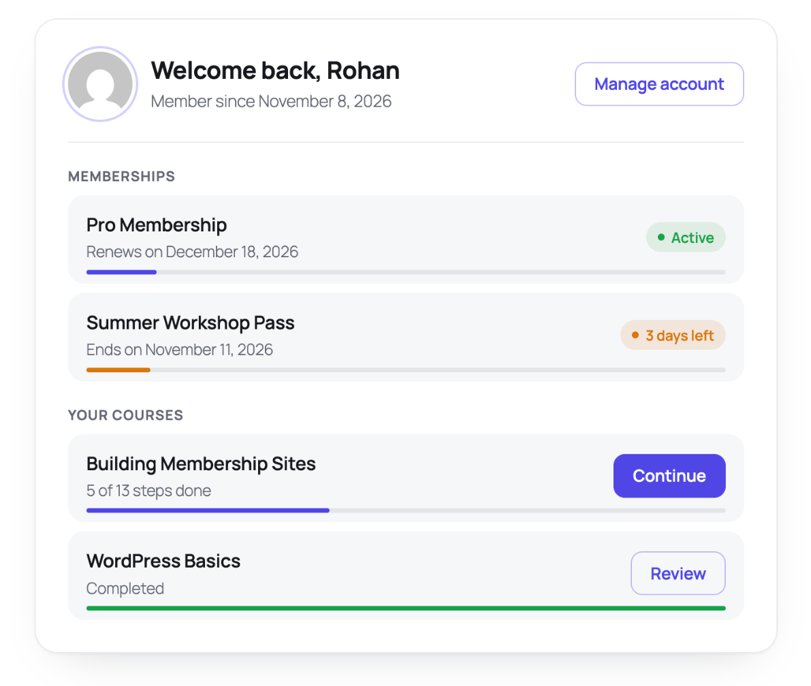

# Member Snapshot

[Screenshots and step-by-step setup tutorial](https://memberfix.studio/plugins/member-snapshot/)

**One clean card that shows members what they've paid for and where they are.**

Members of a MemberPress site often can't tell which plan they're on, when it renews or how far through a course they are without clicking through several account tabs. Member Snapshot puts all of that in one card you can drop on any page.



## What members see

- **Their memberships** from MemberPress, each with a status:
  - **Active**: shows the renewal date, or the end date for one-off plans
  - **Ending soon**: a non-renewing plan with 14 days or less left, shown in amber
  - **Lifetime**: never expires
- **A progress line** under each plan showing how much of the current term is left.
- **Their LearnDash courses** with progress, "6 of 10 steps done", and a *Start*, *Continue* or *Review* button. Unfinished courses come first.
- **A friendly log-in card** for visitors who aren't logged in.

## Why it's nice to use

- **Drop in and done.** Add the **Member Snapshot** block or the `[member_snapshot]` shortcode. There's no settings page.
- **Preview before anyone joins.** In the editor the card fills with sample data, so you can see the design straight away. Sample data is only ever shown to editors, never to members.
- **Works with what you have.** MemberPress only, LearnDash only, or both. Sections for plugins you don't use stay hidden.
- **Fits your theme.** It uses your theme's font. Set one CSS variable to match your brand: `.ms-card-wrap { --ms-accent: #0f766e; }`
- **Accessible.** Course progress bars expose their values to screen readers, focus states are visible and it works at phone width.

## Usage

Block: add **Member Snapshot** in the editor. In the sidebar you can change the heading and turn sections on or off.

Shortcode:

```
[member_snapshot]
[member_snapshot show="memberships" title="Your plan"]
[member_snapshot show="courses"]
[member_snapshot demo="1"]   (sample data, visible to editors only)
```

## For developers

Every data source goes through a filter, so you can add rows from other plugins:

```php
add_filter( 'member_snapshot_memberships', function ( $rows, $user_id ) {
	// Each row: title, status (active|ending|lifetime), expires (timestamp|null), renews, progress, url
	return $rows;
}, 10, 2 );

add_filter( 'member_snapshot_courses', function ( $rows, $user_id ) {
	// Each row: title, url, percent, completed, total
	return $rows;
}, 10, 2 );

add_filter( 'member_snapshot_account_url', function () {
	return home_url( '/account/' );
} );
```

## Install

1. Download this repository as a ZIP.
2. Upload it in **Plugins → Add New → Upload Plugin** and activate it.

Requires WordPress 6.3+ and PHP 7.4+. No build step.

## License

GPL-2.0-or-later. Built by [Rohan Salave](https://www.linkedin.com/in/rohan-salave-362475189/). Not affiliated with MemberPress or LearnDash.
